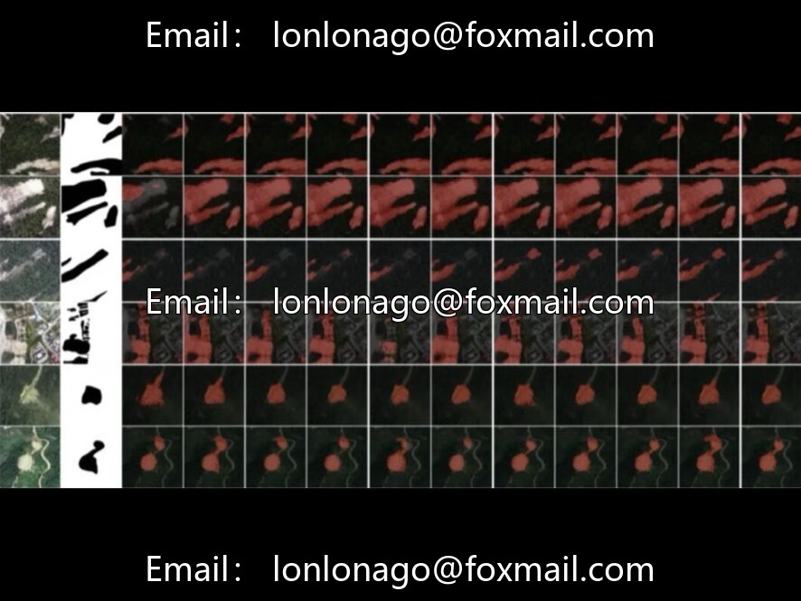
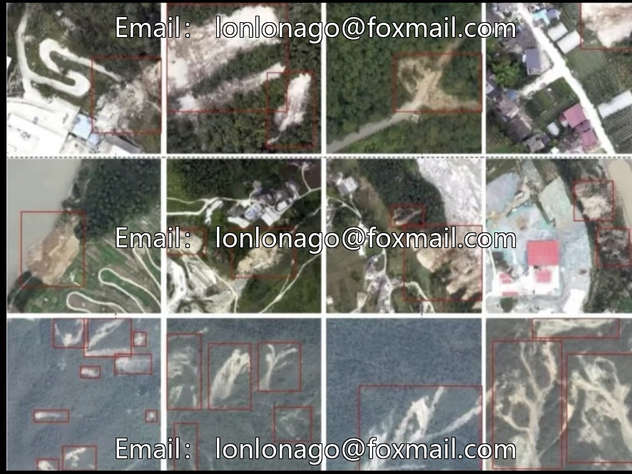

# Landslide Intelligent Detection Satellite UAV Multi-source Imagery Data Set, Deep Learning Semantic Segmentation Open

## Body

Landslide Intelligent Recognition Remote Sensing Satellite Drone Multi-source Imagery Data Set, Deep Learning Semantic Segmentation Open Source Benchmark

Data Volume: 20,865 high-resolution remote sensing images, total capacity of 8.55GB
Coverage Area: 9 major typical landslide disaster areas, including earthquake-induced landslide scenes both domestic and international
Image Sources: PlanetScope, SuperView-1, GF-1 satellite + UAV aerial photography
Resolution: Multi-scale coverage from 0.2m/0.5m/0.6m/1.0m
Standard Format: 512×512 pixels TIFF format, RGB three bands
Annotation System: Classification labels + pixel-level masks, compatible with semantic segmentation/object detection
Application Directions: Landslide identification, disaster inventory mapping, training of semantic segmentation models

The dataset includes multiple typical landslide cases, supports multi-scale analysis, has a complete annotation system, is suitable for scenarios such as landslide identification, disaster inventory mapping, and training of semantic segmentation models, accelerating the iterative development of intelligent landslide recognition technology.

Virtual materials, once sold, are non-refundable.
Interested friends, click "I want" to proceed.

## Images

## Payment

Here is a pay link on Stripe ( https://buy.stripe.com/3cs8yP7sY87d0vu9AB ). Please contact me lonlonago@foxmail.com after funding $89, and I will send you a complete data files , thank you!

